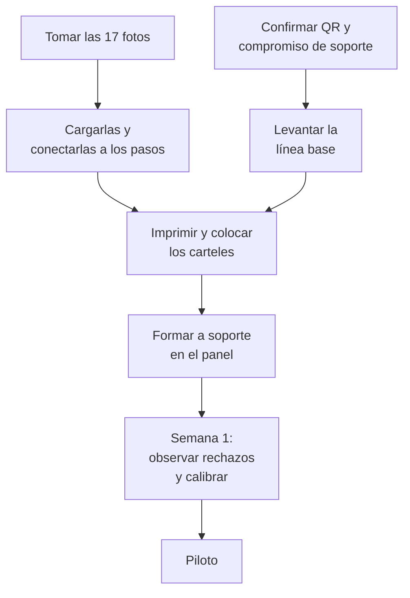

# 15 · Estado real del piloto

> **Qué encuentras aquí:** qué está probado de verdad y qué todavía no, con las cifras
> exactas de hoy. Es el documento que responde las preguntas incómodas antes de que las
> haga el jurado.
>
> **Fecha de corte: 17 de septiembre de 2026.**

---

## 15.1 Cómo leer este documento

Describe **una situación transitoria**. Lo que aparece como «falta» se resuelve cargando
información o ejecutando el piloto, no programando.

Este documento se reescribió el 17 de septiembre, cuando entraron los datos reales del
checklist de soporte. La versión anterior describía un sistema con 121 aulas de
demostración y cero documentos; **ya nada de eso es cierto**, y por eso el documento se
rehízo entero en lugar de parchearse.

---

## 15.2 La separación entre software y datos

| Dimensión | Estado |
|---|---|
| **Código** | ✅ Terminado. 132 rutas, 573 pruebas en verde, análisis estático limpio |
| **Catálogo de aulas y equipos** | ✅ **Cargado y real** |
| **Procedimientos de diagnóstico** | ✅ **Ocho árboles publicados** |
| **Corpus para la IA** | ✅ **Ocho guías, 46 fragmentos indexados** |
| **Fotos de los equipos** | ⬜ **Ninguna** — es lo único que bloquea |
| **Piloto ejecutado** | ⬜ No iniciado |
| **Calibración de parámetros** | ⬜ Pendiente de datos del piloto |

Hasta el 10 de septiembre el cuello de botella era la información. Hoy ya no: **lo único
que falta para que el diagnóstico esté completo son las fotografías de los equipos.**

---

## 15.3 Qué hay hoy en la base de datos

Cifras exactas al 17 de septiembre de 2026:

| Tabla | Registros | Origen |
|---|---|---|
| Sedes | 1 | Huancayo |
| Pabellones | 10 | B, C, D, E, G, H, I, J, K, L — **del checklist real** |
| Pisos | 47 | Deducidos del código de cada aula, incluido el sótano |
| **Aulas** | **212** | **Reales.** 198 con autoservicio + 14 HYFLEX |
| **Equipos** | **1 551** | Reales, según lo que el checklist marca por aula |
| Aulas de demostración | **0** | Purgadas |
| Categorías activas | 9 | Los 8 equipos del checklist + «Otro problema» |
| Árboles de diagnóstico | 8 | Uno por equipo, 92 pasos en total |
| **Guías para la IA** | **8** | 46 fragmentos indexados y en uso |
| Imágenes | 6 | **Todas de demostración.** Ver 15.4 |
| **Incidencias reales** | **0** | El contador está a cero, listo para el piloto |

### La cifra que cambió todo

Hasta hace una semana había **cero documentos cargados** y el asistente respondía «no lo
sé» a cualquier pregunta. Hoy hay **46 fragmentos indexados** y responde citando la fuente.
Esa era la función más visible del sistema y no se podía demostrar; ahora sí.

---

## 15.4 Lo único que bloquea: las fotos

Los ocho árboles de diagnóstico piden **17 imágenes distintas** y **no existe ninguna**.
Las seis que hay en el banco son de demostración y no corresponden a los equipos reales.

| Clave que espera el sistema | Qué foto hace falta |
|---|---|
| `computer_power` | Botón de encendido del AIO |
| `power_strip` | Regleta del aula con su interruptor |
| `projector_leds` | Luces indicadoras del proyector |
| `projector_power` | Llave de pared del proyector |
| `projector_remote` | El control, con los botones visibles |
| `remote_batteries` | Compartimento de pilas abierto |
| `projector_no_signal` | La pared mostrando «Sin señal» |
| `hdmi_port` | Puerto HDMI de la computadora |
| `win_p` | El menú de Windows + P |
| `screen_switch` | Interruptor de pared del ecran |
| `screen` | El ecran bajado |
| `volume_icon` | El ícono de volumen de Windows |
| `speaker` | Parlante del aula y su perilla |
| `audio_jack` | Cable verde de audio conectado |
| `usb_port` | Puertos USB de la computadora |
| `mouse_batteries` | Pilas del mouse |
| `keyboard_leds` | Luces del teclado |

**El diagnóstico funciona sin ellas**: ningún docente se queda atascado. Pero «revisa el
cable HDMI» no significa nada para quien no sabe cuál es, y la imagen es exactamente lo
que convierte el procedimiento en algo seguible. Es también una variable de la
investigación: el sistema registra qué imágenes se mostraron en cada paso para poder
responder si ayudan.

---

## 15.5 Lo que está verificado

| Verificado | Cómo |
|---|---|
| El flujo completo del docente, con datos reales | Recorrido manual en navegador desde el QR hasta el ticket |
| La pantalla única de ubicación filtra bien | Probado con pabellón G: sótano y pisos 1 a 8, solo los que existen |
| Los tres atajos del checklist | C201-A sin parlante, G802 sin ecran, C305 directo a soporte |
| El árbol de HDMI resuelve y escala | Los cuatro pasos recorridos en navegador |
| El asistente responde citando fuentes | Probado contra el modelo real con las guías cargadas |
| El asistente escala ante preguntas ajenas | Dos de tres sondas. Ver 15.7 |
| El modelo clasifica vocabulario peruano | «cañón», «compu», «no jala» |
| No hay fuga temporal en el modelo de riesgo | Suite dedicada |
| El sistema funciona con la IA apagada | Las 573 pruebas corren sin Ollama |
| La comparación de texto no depende de la máquina | Prueba que cambia la codificación interna de PHP |

---

## 15.6 Los supuestos, revisados

Cuatro de los ocho supuestos originales quedaron **confirmados o corregidos** por el
checklist real:

| # | Supuesto original | Qué pasó |
|---|---|---|
| 2 | Pabellones C, D, E, G, H, I, J | ❌ **Falso.** Son diez: también B, K y L |
| 3 | Cinco pisos por pabellón | ❌ **Falso.** G llega al 8, H al 9, y hay sótano |
| 6 | Hay manuales de los equipos | ❌ **Falso.** No existían. Se escribieron ocho guías propias |
| — | Todas las aulas son iguales | ❌ **Falso.** 14 HYFLEX, 30 sin parlante, 3 sin ecran |

Los que **siguen sin confirmar**, y son los que importan:

| # | Supuesto | Impacto si es falso |
|---|---|---|
| 1 | Se autoriza poner el QR en las aulas | **Bloqueante.** Sin QR no hay canal |
| 4 | Existe personal de soporte que atenderá los tickets | **Bloqueante.** Sin soporte no hay ciclo |
| 5 | Se puede instalar en una computadora de la universidad | Se resuelve con un equipo propio |
| 7 | Los docentes tienen celular con cámara y datos | Muy probable, no verificado |
| 8 | La red del aula llega al servidor | Depende de dónde se instale |

---

## 15.7 Lo que se sabe que falla

Esto es lo que un jurado preguntaría, y conviene tenerlo escrito antes.

### El asistente todavía responde a una pregunta ajena de cada tres

Se probó con tres preguntas fuera del dominio. Dos escalan correctamente; **«dónde queda
la biblioteca» todavía obtiene respuesta**, porque coincide con un encabezado de las guías
que dice «Dónde está saliendo el sonido».

**Por qué no se arregló subiendo el umbral:** se midió, y las bandas se solapan. Las
preguntas ajenas al dominio dieron similitudes de hasta 0,602; las legítimas, desde 0,582.
Ningún umbral único las separa, porque el modelo de vectores comprime las similitudes en
una banda estrecha.

Lo que sí funcionó fue exigir que **las dos búsquedas coincidan**: en las preguntas
legítimas el mejor fragmento estaba arriba en el ranking léxico y en el semántico; en las
ajenas, el que ganaba por léxico caía al puesto 22 o más en el semántico.

Los dos umbrales actuales salen de **cinco preguntas de prueba, no de un conjunto
etiquetado**. Afinarlos más sería ajustar números a ejemplos inventados. Es exactamente el
trabajo que resuelve el conjunto etiquetado del piloto.

### Las guías no son normativa institucional

Las escribió el equipo del proyecto porque soporte no tenía procedimientos. El contenido
es técnicamente correcto y verificable —revisar un cable HDMI se hace igual en cualquier
aula— pero **nadie de la universidad las ha aprobado**. Cada archivo lo dice en su primera
línea, y esa advertencia viaja dentro del texto porque el archivo se puede descargar.

### Dos defectos que la integración continua y las pruebas reales encontraron

Vale la pena citarlos porque demuestran que el proceso funciona:

| Defecto | Cómo apareció |
|---|---|
| La comparación de palabras dependía de la configuración de PHP | La integración continua, en su primera ejecución. 436 pruebas en verde sobre Windows no lo habían visto |
| El asistente buscaba en versiones obsoletas de las guías | Al recargar las guías y ver que los fragmentos se duplicaban |

---

## 15.8 Los parámetros sin calibrar

| Parámetro | Valor hoy | Cómo se fija |
|---|---|---|
| Umbral de confianza alto | Vacío → usa 0,75 | Conjunto de preguntas etiquetadas |
| Umbral de confianza bajo | Vacío → usa 0,45 | Igual |
| **Piso de relevancia** | 0,65 | Igual. Medido con 5 preguntas, no calibrado |
| **Acuerdo entre rankings** | Posición 10 | Igual |
| Ventana de duplicado | 15 min | Observando los rechazos la primera semana |
| Máximo activo por aula | 3 | Igual |
| Máximo por dispositivo/hora | 3 | Igual |
| Máximo por red/hora | 30 | Igual |
| Bandas de riesgo | 0,33 / 0,66 | Con la distribución real de scores |

**Todos están elegidos del lado conservador**: el sistema prefiere escalar de más. Esa
asimetría es deliberada y está documentada en [07](07-inteligencia-artificial.md).

---

## 15.9 Lo que no existe todavía

| Falta | Para qué haría falta | Prioridad |
|---|---|---|
| **Las 17 fotos de los equipos** | Que el diagnóstico se entienda | **Bloqueante** |
| **Línea base pre-sistema** | Poder afirmar que el sistema mejoró algo | **Crítica** |
| **Conjunto de preguntas etiquetado** | Calibrar los umbrales y medir el acierto | Alta |
| **Aprobación institucional del QR** | Sin ella no hay canal | **Bloqueante** |
| **Revisión de las guías por soporte** | Convertirlas en normativa | Media |
| **Aprobación ética** | Recoger datos de personas | Depende de la universidad |

### La línea base sigue siendo lo más crítico y lo más olvidado

Sin saber cuánto tardaba el proceso **antes**, «¿el sistema redujo el tiempo de
interrupción?» no tiene respuesta posible. Y hay que hacerla **antes de encender el
sistema**: después ya no se puede observar el proceso anterior.

---

## 15.10 Qué se puede afirmar hoy

### Sí

- Que existe un sistema funcional que cubre el ciclo completo de la incidencia con el
  **catálogo real de 212 aulas y 1 551 equipos** de la sede Huancayo.
- Que el sistema solo ofrece al docente los equipos que su aula tiene registrados, y que
  por tanto es imposible abrir un ticket contra un equipo inexistente.
- Que el asistente responde citando fuentes verificables y escala cuando no las tiene.
- Que la arquitectura opera con y sin modelo de lenguaje.
- Que el módulo predictivo no incurre en fuga temporal, verificado por pruebas.

### **No**

- Que el sistema reduce el tiempo de interrupción de clase. *(No hay línea base ni piloto.)*
- Que los docentes lo prefieren al canal informal. *(No se ha usado en producción.)*
- Que el asistente resuelve un porcentaje X de consultas. *(No hay conjunto etiquetado.)*
- Que la señal de riesgo anticipa incidencias. *(Cero incidencias registradas.)*
- **Ninguna cifra de resultado.** El contador está a cero.

---

## 15.11 Qué falta para arrancar el piloto

| # | Paso | Quién |
|---|---|---|
| 1 | Tomar las 17 fotos de los equipos | Investigador + soporte |
| 2 | Cargarlas y conectarlas a los pasos | Investigador |
| 3 | Confirmar autorización del QR y compromiso de soporte | Universidad |
| 4 | Levantar la línea base | Investigador |
| 5 | Imprimir y colocar los carteles | Investigador |
| 6 | Formar a soporte en el panel | Investigador |
| 7 | Primera semana: observar y calibrar | Investigador |

Los pasos 1-2 y 3-4 son independientes y se pueden hacer en paralelo.

---

## 15.12 Resumen para citar en la tesis

> A la fecha de este informe, el desarrollo del sistema se encuentra concluido y verificado:
> la totalidad de los casos de uso especificados está implementada y cubierta por 504
> pruebas automatizadas, con análisis estático sin observaciones. El catálogo institucional
> se encuentra cargado con datos reales —212 ambientes y 1 551 equipos de la sede
> Huancayo— obtenidos del inventario de soporte técnico, y el corpus documental del
> asistente comprende ocho guías técnicas con 46 fragmentos indexados. No se dispone aún
> del material fotográfico de los equipos, requisito para la comprensibilidad del
> diagnóstico guiado. La instancia no contiene incidencias registradas, por lo que ninguna
> cifra de resultado puede reportarse en esta etapa. Los parámetros que requieren
> calibración empírica se mantienen en valores conservadores documentados, en tanto su
> asignación definitiva requiere el conjunto de consultas etiquetadas que producirá el
> piloto.
